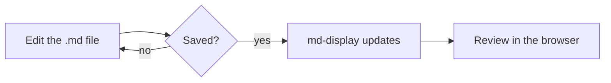
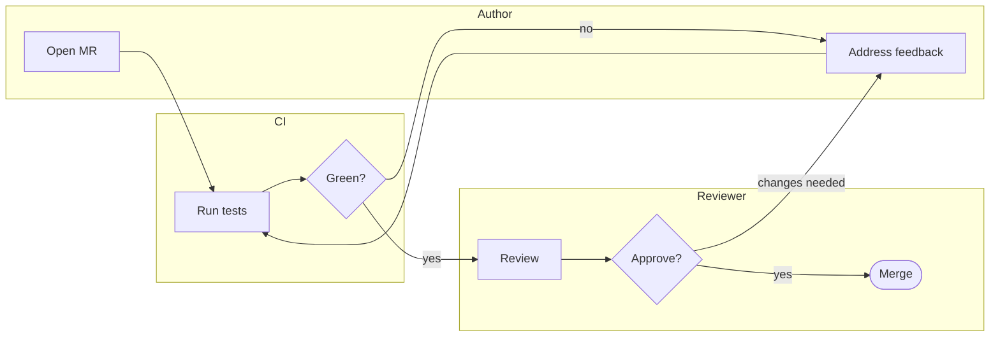
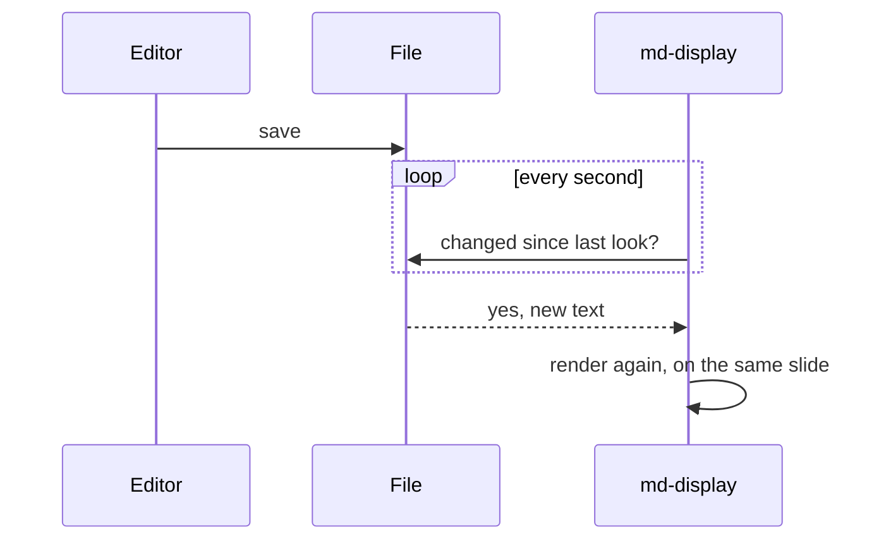
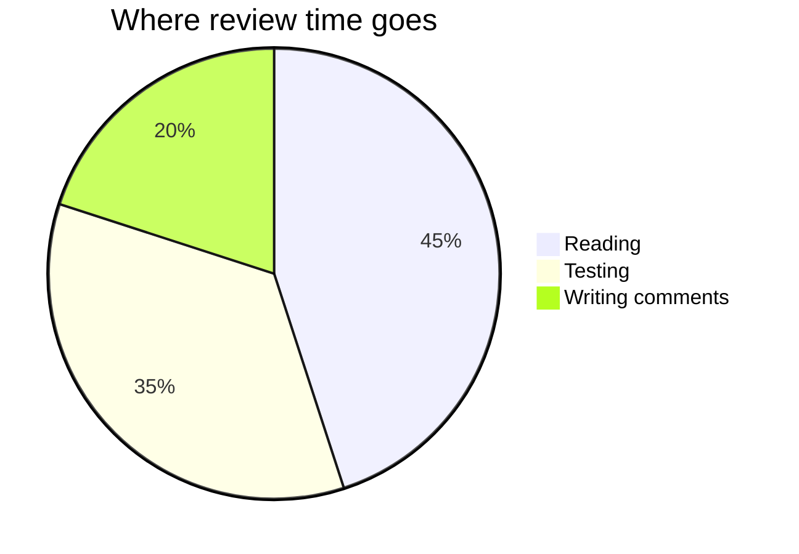

<!-- _class: lead -->
<!-- _paginate: false -->
<!-- _header: "" -->

# md-display

*by Chris Gathercole*

**Local markdown files and slides rendered in your browser, updated live**

<span class="muted">From a small script to preview md files being edited, then why not mermaid diagrams, then why not slides, and ofc speaker notes, thumbnails, TOC, and then why not as a web page? Just kept following "why not?"</span>

<!--
This is a speaker note. Any HTML comment that isn't a directive is a note.
Press n (or use the toolbar button) to show or hide notes under each slide.
-->

---

## About this deck

`marp: true` in the front matter turns a file into slides

Everything in [the document demo](md-display-demo.md), as slides, plus what only slides can do

---

## Opening files

- 📄 **Open file…** or 📁 **Open folder…**, or drop files or a folder on the page
- Open the folder when a deck has images or links: the page can only read what you opened
- Nothing is uploaded. The page reads the files on your computer

<!--
Where a slide shows Markdown source, what it renders as is beside it.
-->

---

<!-- _class: lead -->

# The viewer

<span class="muted">Live updates · Navigation · Toolbar · Working offline</span>

---

## Live updates

- Chrome, Edge and other Chromium browsers: saving the file updates the slides within about a second, even while presenting
- The page remembers what you opened. The browser may ask once, with a ↩️ **Reopen** button
- Firefox and Safari read a copy: 🔄 **Reload** (<kbd>l</kbd>) picks up changes

---

## Navigation

- The left nav lists every slide, by its first heading. Clicking one scrolls to it, and the nav highlights the slide you're on
- Slides are indented by heading level: `#` slides are sections, `##` and `###` slides sit under them
- The dropdown at the top switches between the files you opened, then these demo files

---

## Toolbar

<div class="columns">
<div>

### Document group

- 📄 **Show as document** (<kbd>s</kbd>)
- 📋 **Copy for Slack**: Slack's mrkdwn
- ⬇️ **Download raw Markdown**

The **Open** group above them opens files

</div>
<div>

### Slides group

- 📝 **Show raw Markdown** (<kbd>r</kbd>)
- 🗒️ **Show speaker notes** (<kbd>n</kbd>)
- ▶️ **Present** (<kbd>f</kbd>)
- 🖨️ **Save slides as PDF**

A plain document has only the Document group, with Print instead

</div>
</div>

---

## Working offline

- After your first visit, md-display works offline, Mermaid diagrams included
- In Chrome or Edge, install it from the address bar: it gets its own window, and opens `.md` files from your file manager

<!--
Installing is optional. Everything else works the same in a normal tab.
-->

---

<!-- _class: lead -->

# Text

<span class="muted">Inline formatting · Line breaks · Quotes and rules · Raw HTML</span>

---

## Inline formatting

<div class="columns">
<div>

```markdown
**Bold**, *italic*, ***both***,
~~strikethrough~~, `inline code`,
[a link](https://gitlab.com)
and a bare URL:
https://docs.gitlab.com
```

</div>
<div>

**Bold**, *italic*, ***both***,
~~strikethrough~~, `inline code`,
[a link](https://gitlab.com)
and a bare URL:
https://docs.gitlab.com

</div>
</div>

---

## Line breaks

<div class="columns">
<div>

```markdown
On slides, a single newline
is a line break.

A backslash\
works too.
```

</div>
<div>

On slides, a single newline
is a line break.

A backslash\
works too.

</div>
</div>

In a document, a single newline joins lines into one paragraph, as on GitLab

---

## Quotes and rules

<div class="columns">
<div>

```markdown
> A blockquote.
>
> > A nested one.

***
```

</div>
<div>

> A blockquote.
>
> > A nested one.

***

</div>
</div>

`---` starts a new slide, so use `***` or `___` for a rule on a slide

---

## Raw HTML

HTML passes straight through: <kbd>Ctrl</kbd> + <kbd>C</kbd>, H<sub>2</sub>O, E = mc<sup>2</sup>, <mark>highlighted</mark>

<details>
<summary>Click to expand</summary>

Markdown works inside an HTML block with blank lines around it: **bold** and a list:

- one
- two

</details>

---

<!-- _class: lead -->

# Lists

md-display follows CommonMark, so lists behave as they do on GitLab

<span class="muted">Nesting and numbering · A line starting with an issue reference</span>

---

## Nesting and numbering

<div class="columns">
<div>

```markdown
Straight after a paragraph:
- nesting with two spaces
  - like this
- back out

1. Ordered
2. Lists
   1. nest too
```

</div>
<div>

Straight after a paragraph:
- nesting with two spaces
  - like this
- back out

1. Ordered
2. Lists
   1. nest too

</div>
</div>

---

## A line starting with an issue reference

A line that starts with an issue reference stays a paragraph, not a heading:

#42 needs no escaping at the start of a line.

---

# Code

Fenced code blocks keep their language tag, but they aren't syntax-highlighted

```python
def greet(name: str) -> str:
    return f"Hello, {name}"
```

---

<!-- _class: lead -->

# Tables

Column headings are centred by default. Row headings need no new syntax, and still look ordinary on GitLab

<span class="muted">Alignment · Row headings (two ways) · Optional outer pipes</span>

---

## Alignment

<div class="columns">
<div>

```markdown
| Left | Centre | Right |
|:---|:---:|---:|
| a | b | c |
| longer | 1.5 | 100 |
```

</div>
<div>

| Left | Centre | Right |
|:---|:---:|---:|
| a | b | c |
| longer | 1.5 | 100 |

</div>
</div>

Column headings are centred by default. An explicit `:---`, `:---:` or `---:` overrides that

---

## Row headings, option 1: empty top-left cell

<div class="columns">
<div>

```markdown
|  | Q1 | Q2 | Q3 |
|---|---|---|---|
| North | 12 | 15 | 9 |
| South | 8 | 11 | 14 |
```

</div>
<div>

|  | Q1 | Q2 | Q3 |
|---|---|---|---|
| North | 12 | 15 | 9 |
| South | 8 | 11 | 14 |

</div>
</div>

The whole first column becomes row headings, with the corner left blank

---

## Row headings, option 2: a bold first cell

<div class="columns">
<div>

```markdown
| Region | Q1 | Q2 |
|---|---|---|
| North | 12 | 15 |
| South | 8 | 11 |
| **Total** | 20 | 26 |
```

</div>
<div>

| Region | Q1 | Q2 |
|---|---|---|
| North | 12 | 15 |
| South | 8 | 11 |
| **Total** | 20 | 26 |

</div>
</div>

Only that row gets a heading. Both conventions look ordinary on GitLab

---

## Optional outer pipes

<div class="columns">
<div>

```markdown
Region | Q1 | Q2
---|---|---
North | 1 | 2
| South | 3 | 4 |
```

</div>
<div>

Region | Q1 | Q2
---|---|---
North | 1 | 2
| South | 3 | 4 |

</div>
</div>

Outer pipes are optional row by row, as on GitLab

---

# Links between documents

<div class="columns">
<div>

```markdown
[The document demo](md-display-demo.md)
or [its Tables section](
md-display-demo.md#tables)
```

</div>
<div>

[The document demo](md-display-demo.md)
or [its Tables section](md-display-demo.md#tables)

</div>
</div>

A link to another file in the dropdown opens it here, `#section` included. On GitLab it opens the file there

<!--
A link to a file that isn't open is greyed out. Open the folder that holds both files to follow it.
-->

---

# Front matter

<div class="columns">
<div>

```yaml
---
marp: true
title: md-display slide demo
paginate: true
header: md-display slide demo
footer: Set in front matter…
---
```

</div>
<div>

This deck's front matter sets its global directives

In document view (<kbd>s</kbd>) it shows as a YAML code block, as on GitLab

</div>
</div>

---

# Images

<div class="columns">
<div>

```markdown

```

A relative path resolves against the deck's own folder. Open the folder, not just the file, so the page can read the image

</div>
<div>


</div>
</div>

---

<!-- _class: lead -->

# Mermaid diagrams

A ` ```mermaid ` block is drawn as a diagram, as GitLab does. On a slide it shrinks to fit

<span class="muted">Flowchart · Swim lane diagram · Sequence diagram · Pie chart</span>

<!--
The diagram library is part of md-display, so diagrams work offline. It's only loaded for a file that has one. Diagrams on slides stay light, like the slides, in dark mode.
-->

---

## Flowchart



---

## Swim lane diagram



<!--
Mermaid has no swim lane diagram type. A flowchart with one subgraph per lane does the job, with links between steps in different lanes. Mermaid lays the lanes out itself, so they won't always line up as even bands.
-->

---

## Sequence diagram



---

## Pie chart



---

<!-- _class: lead -->

# Slide decks

What only slides can do

<span class="muted">Directives · Columns · Colours · Images · Presenting · Too much content</span>

---

## How slides work

- `---` on its own line starts a new slide
- Front matter sets **global** directives
- `<!-- key: value -->` applies from this slide onwards
- `<!-- _key: value -->` applies to this slide only

On slides, a single newline
is a line break, as in Marp.

<!--
Speaker notes can span several lines, and they print on the PDF when notes
are showing.
-->

---

<!-- footer: This footer was set by a directive on this slide, and applies from here on -->

## Persistent directives

`<!-- footer: … -->` changed the footer from this slide onwards

---

## Two columns

<div class="columns">
<div>

### Left

- Markdown works inside the column `<div>`s
- Leave a blank line after the opening tag

</div>
<div>

### Right

| Option | Value |
|---|---|
| Pages | 16 |
| Size | 16:9 |

</div>
</div>

---

## Three columns

<div class="columns-3">
<div>

### Plan
Agree the scope

</div>
<div>

### Build
Write it test-first

</div>
<div>

### Ship
Release and deploy

</div>
</div>

---

## Palette colours

Text classes: <span class="primary">primary</span>, <span class="accent">accent</span>, <span class="success">success</span>, <span class="warning">warning</span>, <span class="danger">danger</span>, <span class="muted">muted</span>

Highlights: <span class="bg-success">passed</span> <span class="bg-warning">flaky</span> <span class="bg-danger">failed</span>

The classes work in documents too. The colours are set in `src/styles/slides.css`

---

<!-- _class: bg-primary -->

## A palette background

`<!-- _class: bg-primary -->` colours the whole slide

---

<!-- _class: invert -->

## The `invert` class

A dark slide, with code and tables restyled to match:

```python
print("hello from a dark slide")
```

---

<!-- _backgroundColor: "#fff8c5" -->
<!-- _color: "#6e4c00" -->

## Custom colours

`backgroundColor` and `color` directives take any CSS colour

---

## Sized images

 

`` and `` size images in slide pixels, so they scale with the slide

---


<!-- _class: invert -->

## Full-slide background

``

---


## Split background

`` puts the image on the right, taking 40% of the width

The content stays on the other side

---


## Fitted, on the left

`` keeps the whole image visible

Other sizes: `fit`, `auto`, `cover` (the default) or a percentage

---

## Presenting and exporting

- ▶️ **Present** (<kbd>f</kbd>): one slide at a time, full screen. <kbd>t</kbd> thumbnails, <kbd>n</kbd> notes, <kbd>c</kbd> timer, <kbd>i</kbd> contents; <kbd>f</kbd> or <kbd>Esc</kbd> leaves
- 🗒️ **Show speaker notes** (<kbd>n</kbd>) shows notes under each slide
- 🖨️ **Save slides as PDF**: one slide per page, or each above its notes on A4 when notes show
- 📄 **Show as document** (<kbd>s</kbd>): slide breaks become rules, comments are hidden
- 📝 **Show raw Markdown** (<kbd>r</kbd>) shows this deck's source

<!--
Presenting? Press n to see this note in the corner, c for a timer, and i for this deck's contents down the left of the slide. The audience sees both. Move them with `notesPosition` and `timerPosition` in front matter (`top-left`, `top-right`, `bottom-left` or `bottom-right`).
-->

---

## Too much content

This slide has more than fits, on purpose. It shows from the top and the rest is cut off. A ⚠️ flags it here, in the nav and in the thumbnails, but never when presenting or in the PDF. Split a flagged slide in two.

- One
- Two
- Three
- Four
- Five
- Six
- Seven
- Eight
- Nine
- Ten
- Eleven
- Twelve

---

# Not supported yet

These render differently here from GitLab, in slides and documents alike:

- Task lists: `- [ ] todo` shows as literal brackets
- Footnotes and GitLab's `[[_TOC_]]`
- `#123` and `!45` references aren't turned into links
- Syntax highlighting in code blocks

---

## Not supported on slides

- Marp themes (`theme:` is ignored)
- `<style scoped>`
- Image filters
- More than one `bg` image per slide
- A presenter view in a second window (private notes, the next slide)

<!--
Last slide. Try toggling notes on and printing to see the A4 layout.
-->
