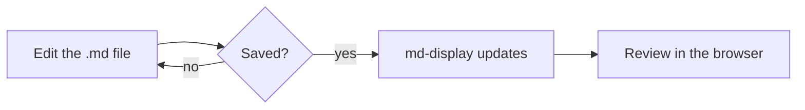
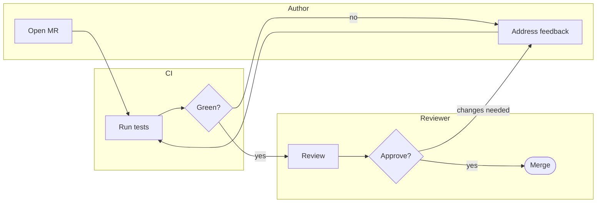
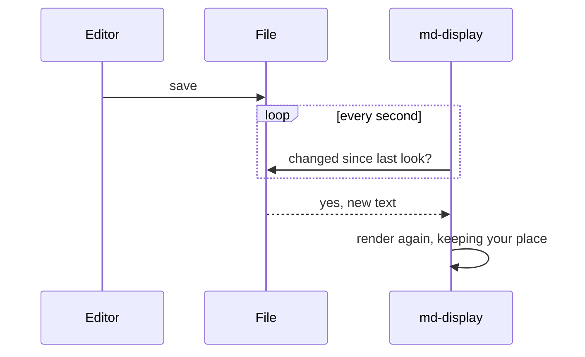
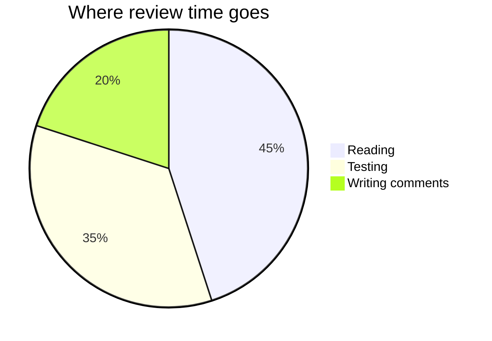

# md-display

*by Chris Gathercole*

**Local markdown files and slides rendered in your browser, updated live**

From a small script to preview md files being edited, then why not mermaid diagrams, then why not slides, and ofc speaker notes, thumbnails, TOC, and then why not as a web page? Just kept following "why not?"

## About this demo

This document uses every feature md-display supports in a document. Its
companion deck, [the slide demo](md-display-demo-slides.md), has the same
content as slides, plus the features only slides have. Those are summarised
under [Slide decks](#slide-decks) below.

Each section shows the Markdown source first, then what it renders as.
Everything here also renders correctly on GitLab, except where a section says
otherwise.

## The viewer

### Opening files

- 📄 **Open file…** opens one or more Markdown files, and 📁 **Open folder…**
  opens a folder and every Markdown file in it. You can also drop files or a
  folder anywhere on the page.
- Open the folder, not just the file, when a document has images or links to
  other documents: the browser only lets the page read what you opened.
- The dropdown at the top of the nav switches between the files you opened,
  followed by these demo files.

### Live updates

In Chrome, Edge and other Chromium browsers, saving the open file updates the
page within about a second, keeping your place. The page also remembers what
you opened, so it's there again next time; the browser may ask you to allow
it once, with a ↩️ **Reopen** button.

Firefox and Safari can't watch files, so they read a copy when you open it.
Press 🔄 **Reload** (<kbd>l</kbd>) and choose the file again to see changes.

### Navigation

The left nav lists every `#`, `##` and `###` heading. Clicking one scrolls to
it, and the nav highlights whichever section you're reading.

### Toolbar

The buttons come in groups. **Open** opens files, and **Document** acts on
the document as a whole. A Marp deck also gets a **Slides** group, described
under [Slide decks](#slide-decks).

| Button | What it does |
|---|---|
| 🖨️ Print / Save as PDF | Opens the browser's print dialog with a print stylesheet (no nav). Choose "Save as PDF" there. |
| 📄 Show as document / 🎞️ Show as slides | Marp decks only: switches between slides and a plain rendering of the same Markdown. Shortcut <kbd>s</kbd>. Remembered for each file while the tab is open. |
| 📝 Show raw Markdown | Swaps the rendered view for the source. Shortcut <kbd>r</kbd>. Remembered across visits. |
| 📋 Copy for Slack | Converts the document to Slack's mrkdwn and copies it: headings become bold lines, tables become an aligned code block. |
| ⬇️ Download raw Markdown | Downloads the `.md` file as it is. |

### Installing and working offline

After your first visit, md-display works offline, Mermaid diagrams included.

In Chrome or Edge you can also install it, from the install icon in the
address bar. Installed, it opens in its own window, and you can open `.md`
files with it from your file manager ("Open with").

### Keyboard shortcuts

| Key | Does |
|---|---|
| <kbd>r</kbd> | Show or hide the raw Markdown |
| <kbd>l</kbd> | Reload the file (Firefox and Safari) |
| <kbd>s</kbd> | Show a deck as a document, or as slides |
| <kbd>n</kbd> | Show or hide speaker notes (slides) |
| <kbd>f</kbd> | Present (slides); while presenting, <kbd>t</kbd> <kbd>n</kbd> <kbd>c</kbd> <kbd>i</kbd> show thumbnails, notes, a timer and contents |

## Text

### Inline formatting

```markdown
**Bold**, *italic*, ***both***, ~~strikethrough~~, `inline code`,
[a link](https://gitlab.com) and a bare URL: https://docs.gitlab.com
```

**Bold**, *italic*, ***both***, ~~strikethrough~~, `inline code`,
[a link](https://gitlab.com) and a bare URL: https://docs.gitlab.com

### Line breaks

A single newline joins lines into one paragraph, as on GitLab. These two
lines in the source
come out as one line.

End a line with a backslash\
to force a break, or with two trailing spaces.

On slides, a single newline is a line break, as in Marp.

### Quotes and rules

> A blockquote.
>
> > A nested one.

---

The line above is `---`. On a slide that starts a new slide, so use `***` or
`___` for a rule there.

### Raw HTML

HTML passes straight through: <kbd>Ctrl</kbd> + <kbd>C</kbd>, H<sub>2</sub>O,
E = mc<sup>2</sup>, <mark>highlighted</mark>.

<details>
<summary>Click to expand</summary>

Markdown works inside an HTML block as long as there are blank lines around
it, as here: **bold** and a list:

- one
- two

</details>

## Lists

md-display follows CommonMark, so lists behave as they do on GitLab.

### Nesting and numbering

```markdown
A list straight after a paragraph, with no blank line:
- nesting with two spaces
  - like this
    - and deeper
- back out

1. Ordered
2. Lists
   1. nest
   2. too
```

A list straight after a paragraph, with no blank line:
- nesting with two spaces
  - like this
    - and deeper
- back out

1. Ordered
2. Lists
   1. nest
   2. too

### A line starting with an issue reference

A line that starts with an issue reference stays a paragraph, not a heading:

#42 needs no escaping at the start of a line.

## Code

Fenced code blocks keep their language tag, but they aren't syntax-highlighted.

```python
def greet(name: str) -> str:
    return f"Hello, {name}"
```

## Tables

### Alignment

```markdown
| Left | Centre | Right |
|:---|:---:|---:|
| a | b | c |
| longer text | 1.5 | 100 |
```

| Left | Centre | Right |
|:---|:---:|---:|
| a | b | c |
| longer text | 1.5 | 100 |

Column headings are centred by default. An explicit `:---`, `:---:` or `---:`
overrides that.

### Row headings, option 1: empty top-left cell

Leave the corner cell empty and the whole first column becomes row headings:
right-aligned and shaded, with the corner left blank.

```markdown
|  | Q1 | Q2 | Q3 |
|---|---|---|---|
| North | 12 | 15 | 9 |
| South | 8 | 11 | 14 |
```

|  | Q1 | Q2 | Q3 |
|---|---|---|---|
| North | 12 | 15 | 9 |
| South | 8 | 11 | 14 |

### Row headings, option 2: a bold first cell

Make one row's first cell entirely bold and only that row gets a heading,
which is handy for totals.

```markdown
| Region | Q1 | Q2 |
|---|---|---|
| North | 12 | 15 |
| South | 8 | 11 |
| **Total** | 20 | 26 |
```

| Region | Q1 | Q2 |
|---|---|---|
| North | 12 | 15 |
| South | 8 | 11 |
| **Total** | 20 | 26 |

Both conventions still look like an ordinary table on GitLab.

### Optional outer pipes

Outer pipes are optional row by row, as on GitLab:

Region | Q1 | Q2
---|---|---
North | 1 | 2
| South | 3 | 4 |

## Links between documents

A relative link to another file in the dropdown opens it here, and a
`#section` part jumps to that heading (or slide). On GitLab the same link
opens the file there.

```markdown
[The slide demo](md-display-demo-slides.md) or
[its "Two columns" slide](md-display-demo-slides.md#two-columns)
```

[The slide demo](md-display-demo-slides.md) or
[its "Two columns" slide](md-display-demo-slides.md#two-columns)

A link to a file that isn't open is greyed out: open the folder that holds
both files to follow it.

## Front matter

Front matter (a `---`-fenced YAML block at the very top of a file) shows as a
YAML code block, as on GitLab. A Marp deck switched to
[document view](#toolbar) shows its front matter this way too.

## Images

A relative path resolves against the document's own folder:

```markdown

```


The image is read from the folder you opened, so open the folder, not just
the file. An image outside that folder can't be shown, and says so.

## Mermaid diagrams

A ` ```mermaid ` block is drawn as a diagram, as GitLab does. The diagram
library is part of md-display, so it works offline, and it's only loaded for a
document that has a diagram. In dark mode, diagrams in a document are drawn
dark to match.

### Flowchart



### Swim lane diagram

Mermaid has no swim lane diagram type. A flowchart with one `subgraph` per
lane does the job, with links between steps in different lanes. Mermaid lays
the lanes out itself, so they won't always line up as even bands.



### Sequence diagram



### Pie chart



## Slide decks

A file whose front matter sets `marp: true` is shown as slides. None of this
renders in a document, so each row links to its slide in
[the slide demo](md-display-demo-slides.md).

| Feature | What it does |
|---|---|
| [Slides and directives](md-display-demo-slides.md#how-slides-work) | `---` starts a new slide. Front matter sets global directives, `<!-- key: value -->` applies from that slide on, `<!-- _key: value -->` to that slide only: `paginate`, `header`, `footer`, `class`, `backgroundColor`, `backgroundImage`, `color`. 16:9, or `size: 4:3`. |
| [Persistent directives](md-display-demo-slides.md#persistent-directives) | A directive comment changes the rest of the deck, e.g. the footer. |
| [Columns](md-display-demo-slides.md#two-columns) | `<div class="columns">` or `columns-3`, with Markdown inside. |
| [Palette colours](md-display-demo-slides.md#palette-colours) | `primary`, `accent`, `success`, `warning`, `danger`, `muted` as text colours, `bg-*` highlights or whole-slide classes. Also `lead` and `invert`. |
| [Custom colours](md-display-demo-slides.md#custom-colours) | `backgroundColor` and `color` take any CSS colour. |
| [Sized images](md-display-demo-slides.md#sized-images) | ``, `` in slide pixels. |
| [Background images](md-display-demo-slides.md#split-background) | ``, ``, ``; `fit`, `auto`, `cover` or a percentage. |
| [Diagrams](md-display-demo-slides.md#mermaid-diagrams) | Mermaid diagrams shrink to fit the space left on the slide. |
| Speaker notes | Any other HTML comment is a note. 🗒️ **Show speaker notes** (<kbd>n</kbd>) shows them under each slide. |
| [Present](md-display-demo-slides.md#presenting-and-exporting) | ▶️ (<kbd>f</kbd>): one slide at a time, full screen. While presenting, <kbd>t</kbd> shows thumbnails, <kbd>n</kbd> the slide's notes, <kbd>c</kbd> a timer, and <kbd>i</kbd> a contents column inside the slide, like this nav, with the live slide highlighted. The audience sees the notes and timer too. Front matter `notesPosition` and `timerPosition` move them (`top-left`, `top-right`, `bottom-left`, `bottom-right`). |
| 🖨️ Save slides as PDF | One slide per page, or each slide above its notes on A4 when notes are showing. |
| [Too much content](md-display-demo-slides.md#too-much-content) | A slide that doesn't fit is cut off at the bottom and flagged ⚠️ on the slide, in the nav and in the thumbnails. |
| 📄 Show as document | (<kbd>s</kbd>) Shows a deck as a document, as in this file, with its front matter as YAML. |

## Not supported yet

These render differently here from GitLab:

- Task lists: `- [ ] todo` shows as literal brackets.
- Footnotes and GitLab's `[[_TOC_]]`.
- `#123` and `!45` references aren't turned into links.
- Syntax highlighting in code blocks.
- Column layouts work on slides only. See [Slide decks](#slide-decks).
- On slides: Marp themes, `<style scoped>`, image filters, more than one `bg`
  image per slide, and a presenter view in a second window. See
  [the deck's last slide](md-display-demo-slides.md#not-supported-on-slides).
